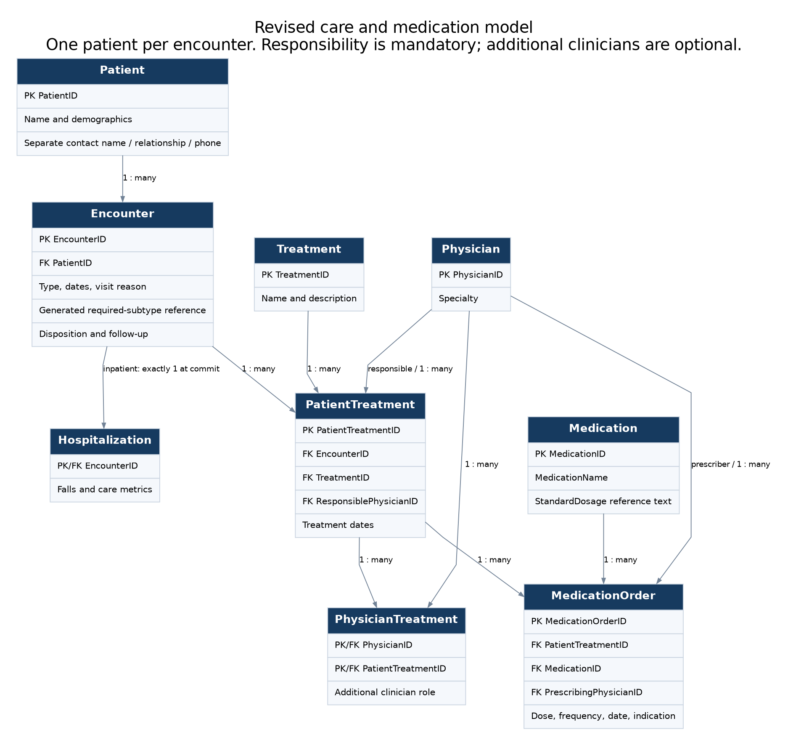

# Healthcare Database: Design Audit and Worked Care Scenarios

An Access coursework project rebuilt in Python and SQLite to demonstrate **relational design, healthcare SQL, data-quality checks, and traceable patient histories**.

The original database had valid foreign keys but could associate one hospital stay with several patients. This version gives each visit one patient owner and uses recognizable care scenarios to show what a correct model can answer.

**All people and events are fictional.** The cases are deliberately authored examples, not a representative patient population. Selected medication orders illustrate record structure; this is not a complete clinical chart or a prescribing system.



## Start with a patient story

**Robert Perez (PatientID 2)** has a coronary-stent admission, returns 20 days after discharge, and later attends cardiac rehabilitation. His records include the treating and consulting physicians, selected maintenance medication orders and their prescribers, a medication-access review, and a transportation barrier addressed at rehabilitation intake.

**Barbara Wilson (PatientID 5)** has a knee replacement and a return admission 31 days after discharge. Her return is correctly excluded from the 30-day readmission list. Her records also demonstrate mobility assistance, a care-planning score, and infection follow-up.

[Read the worked cases and actual query results](docs/SCENARIOS.md). These are example review workflows, not evidence that a particular treatment or barrier caused an outcome.

## What you can investigate

| Question | SQL file |
|---|---|
| Which medications appear in a patient's recorded care, and what catalog effects are listed? | [01_patient_medications.sql](sql/queries/01_patient_medications.sql) |
| What is the average elapsed stay, counting each stay once? | [02_average_stay.sql](sql/queries/02_average_stay.sql) |
| How are the recorded infection episodes distributed by type? | [03_infection_distribution.sql](sql/queries/03_infection_distribution.sql) |
| Which selected medications have the most order records? | [04_medication_orders.sql](sql/queries/04_medication_orders.sql) |
| Which completed stays were followed by another admission within 30 days? | [05_readmissions.sql](sql/queries/05_readmissions.sql) |
| Which high-risk patients need mobility assistance and discharge support? | [06_high_falls_risk.sql](sql/queries/06_high_falls_risk.sql) |
| What happened across this patient's visits, treatments, care team, and medication records? | [07_patient_care_timeline.sql](sql/queries/07_patient_care_timeline.sql) |
| Which physician actually prescribed each recorded medication? | [08_orders_by_prescriber.sql](sql/queries/08_orders_by_prescriber.sql) |
| What were the reasons for 30-day returns, and which were planned? | [09_readmission_review.sql](sql/queries/09_readmission_review.sql) |
| Which infection episodes still lack a documented resolution? | [10_infection_followup.sql](sql/queries/10_infection_followup.sql) |

All reports apply an explicit date policy. Unknown order dates are excluded and counted in `results/report_context.json`; the falls report uses completed-stay snapshots. [Reporting definitions](docs/REPORTING.md) explain each cutoff and the limits of retrospective narratives.

The readmission definition requires a full 30-day observation window, counts same-day returns, and excludes outpatient visits. Planned returns are displayed explicitly in the review worklist; the main indicator includes them. It is not a CMS/HEDIS measure. The 1–10 falls-risk and ADL scores are project-specific scales, not validated instruments.

## Run or edit it without Access

Use Python 3.10+ with SQLite 3.31+ for generated-column constraints and window functions. The main workflow needs only Python's standard library:

```bash
python3 scripts/audit_source.py
python3 scripts/rebuild_synthetic.py
python3 scripts/validate_demo.py
python3 scripts/run_queries.py --patient-id 2 --as-of 2023-12-31
python3 scripts/document_scenarios.py
python3 -m unittest discover -s tests -v
python3 scripts/check_artifacts.py
```

The prebuilt editable database is `data/healthcare_demo.sqlite`. The rebuild replaces that generated file; keep a separate copy of manual edits. Query results are exported to `results/`. GitHub Actions tests the committed database, then rebuilds separately and compares database schemas/rows, CSVs, documentation, manifests, and diagram sources. It fails on stale published artifacts. SQLite binary page layouts are not compared; equivalent databases can have different file bytes.

Open the database in [DB Browser for SQLite](https://sqlitebrowser.org/) on macOS or a SQLite extension in VS Code. Before editing, enable foreign keys on that connection, outside an active transaction:

```sql
PRAGMA foreign_keys = ON;
PRAGMA foreign_keys; -- expect 1
```

Use one transaction when adding an inpatient encounter and its Hospitalization details; the required detail row is checked at commit. See the [editing examples](docs/VALIDATION.md). Run the validation script after editing. The original Access forms/report layouts have not been recreated as an application. Query files use parameters such as `:patient_id` and `:as_of`; the Python runner binds them. Supply those values when running queries directly in an editor.

## See the validation rules

[sql/schema.sql](sql/schema.sql) contains the actual `CHECK`, `NOT NULL`, `UNIQUE`, foreign-key, and trigger definitions. [sql/inspect_validation.sql](sql/inspect_validation.sql) displays the rules stored inside whichever database you have open. [The validation guide](docs/VALIDATION.md) explains how this differs from Access's property pane and which checks run in Python.

```sql
SELECT type, name, tbl_name, sql
FROM sqlite_schema
WHERE type IN ('table', 'trigger') AND name NOT LIKE 'sqlite_%'
ORDER BY tbl_name, type, name;
```

## Audit findings and preservation

| Original finding | Verified extent | Design response |
|---|---:|---|
| Stay linked through treatments to multiple patients | 159 of 200 stays | One required patient owner per encounter |
| Stay with no treatment from which to infer its patient | 7 of 200 | Ownership exists independently of treatments |
| Treatment outside the linked stay dates | 555 of 631 linked treatments | Coherent dates and insert/update triggers |
| Treatment with no physician | 144 of 1,000 | Mandatory responsible physician |
| Empty medication dose strings | 3,000 of 3,000 | NOT NULL plus a nonblank-string check |
| Truncated emergency-contact placeholder | All 500 patients | Explicit fictional named contacts |
| PatientID joined directly to the unrelated stay ID | Two report queries | Correct encounter-based joins |

The original had strengths: eight entity/association tables, seven enforced relationships without orphan references, unique keys, and score-range validation. Several original report results reproduce exactly. [The audit](docs/AUDIT.md) distinguishes those strengths from schema, data, query, and documentation flaws.

The original Access file is unchanged. Its exported rows remain in `data/source/`, and `data/source_snapshot.sqlite` is an analysis copy of those rows. The scenario database retains all **500 patients, 100 physicians, 31 original treatment names, and 20 original medication entries**, including the original dose-reference text. It adds encounter reasons, explicit prescribing identity, meaningful treatment outcomes and roles, and named infection categories with organisms. [Field-by-field preservation notes](docs/FIELD_MAPPING.md) describe what moved, changed, or was regenerated.

[Current generated database counts](README.md#scope).

## Files and reproducibility

- [Worked cases](docs/SCENARIOS.md), [design and dictionary](docs/DESIGN.md), and [validation guide](docs/VALIDATION.md)
- [Original schema](docs/diagrams/original_schema.png) and [effect/infection model](docs/diagrams/revised_details.png)
- [Scenario definitions](scripts/scenarios.py) and [rebuild logic](scripts/rebuild_synthetic.py)
- [Audit results](docs/source_audit_results.json), [rebuild manifest](docs/rebuild_manifest.json), and [verification log](docs/verification_log.json)
- [Clinical context and limits](docs/CLINICAL_CONTEXT.md), [reporting policies](docs/REPORTING.md), and [independent-review fixes](docs/REVIEW_FIXES.md)

Editable Graphviz DOT, SVG, and PNG diagrams are included. To regenerate them, install [Graphviz](https://graphviz.org/) and run `python3 scripts/diagrams.py`. Arrows point from referenced parent to child; labels show maximum cardinality. The dictionary explains required participation.

Optional extraction from your own Access file uses the third-party reader only:

```bash
python3 -m venv .venv
source .venv/bin/activate
python3 -m pip install -r requirements-access.txt
python3 scripts/extract_access.py '/path/to/FinalProject1(1).accdb'
```

This reads tables and metadata; it does not write Access files or convert forms, reports, or VBA. The original file hash is recorded in `data/source/manifest.json`. The instructor's assignment and final Word report are not bundled for public redistribution. `.laccdb` is a temporary Access lock file.

## Attribution

Original database design: **Elias Brown**. Original INSC 384 coursework: **Elias Brown and Brandon Weis**. The final report credits Elias primarily with synthetic data generation and Brandon primarily with queries, with both contributing to both. It discloses ChatGPT assistance with VBA generation. Queries, forms, and reports were completed individually and their evidence compiled into the Word report; their absence as saved objects in this copy of the database is not evidence of omitted work.

The November 2026 audit, Python/SQLite refactor, worked scenarios, tests, and documentation were developed with AI assistance for Elias's portfolio. Version 2 introduced explicit cases. Version 3 addresses independent review with pediatric examples, stronger integrity rules, reporting boundaries, and checks for stale artifacts. These authored events are new fictional scenarios, not recovered clinical histories.
