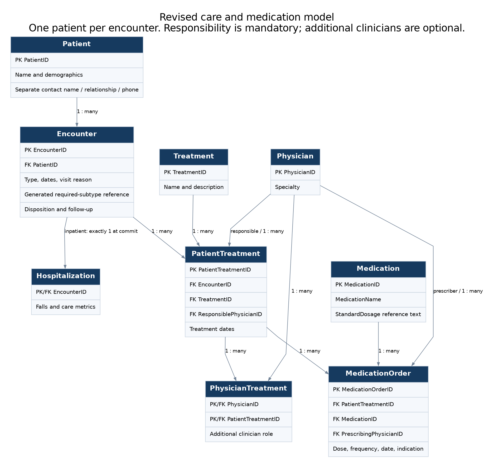

# Healthcare Database Audit and SQL Reporting

[Read the browser report](https://eliasbrown99.github.io/healthcare-database-analysis/)

**Elias Brown · Database design, SQL, Python, and SQLite · Fictional records**

This project follows a patient's care across hospital stays, outpatient visits, treatments, and medication orders. It began with a healthcare database I designed in Microsoft Access. The current Python/SQLite edition adds an audit, a revised schema, ten SQL reports, and worked examples that make the reporting rules inspectable.

The audit found that 159 of 200 original stays were linked through treatments to multiple patients. The revised schema gives each encounter one patient owner. Newly authored fictional scenarios exercise that design; the original source records remain available separately.

[Read the project brief](docs/PROJECT_BRIEF.md) · [Follow a worked case](docs/SCENARIOS.md#robert-perez-continuity-of-care) · [Inspect the SQL](sql/queries/)

## My contribution

I designed the original healthcare database. The coursework was completed with Brandon Weis; the original report credits me primarily with synthetic data generation and Brandon primarily with queries, with contributions from both to both. It also discloses AI assistance with VBA data generation.

The November 2026 audit, SQLite rebuild, additional scenarios, checks, and presentation are later AI-assisted extensions. [Full project history](PROJECT_GUIDE.md#attribution).

## What the revised database can answer

| Question | Reporting choice | Evidence |
|---|---|---|
| What happened during a patient's care? | Keep one timeline row per treatment, even when several physicians or orders are attached. | [Patient timeline](sql/queries/07_patient_care_timeline.sql) |
| Which admissions followed a recent discharge? | Require a full 30-day observation window and identify planned returns separately. | [Return review](sql/queries/09_readmission_review.sql) |
| Who prescribed a medication? | Use the recorded prescriber, rather than every physician associated with a treatment. | [Orders by prescriber](sql/queries/08_orders_by_prescriber.sql) |

Robert Perez's fictional history connects an admission, a return 20 days after discharge, and outpatient rehabilitation. Barbara Wilson's 31-day return is excluded from the 30-day worklist. These examples show how the definitions affect the result.

## Methods and reproduction

The [design notes](docs/DESIGN.md) define what each table represents. The [source audit](docs/AUDIT.md) documents the original inconsistencies, and the [validation guide](docs/VALIDATION.md) explains the database constraints and checks. [Reporting definitions](docs/REPORTING.md) cover dates, missing values, and the limits of retrospective records.

[Run the project](PROJECT_GUIDE.md#run-or-edit-it-without-access) · [Tests](tests/) · [Saved query outputs](results/)

## Scope

All people and events are fictional. The results demonstrate database behavior and reporting logic; they do not estimate hospital performance. The 30-day flag includes planned returns and is not a standardized CMS/HEDIS measure. The [clinical context](docs/CLINICAL_CONTEXT.md) explains the remaining limits.

Database scope

<!-- GENERATED COUNTS -->
The current scenario database has **502 patients (500 original plus 2 supplemental pediatric identities), 200 inpatient stays, 371 outpatient encounters, 1,276 treatment occurrences, and 302 selected medication orders**. Its 1,796 physician assignments comprise 1,276 responsible physicians and 520 additional associations. The catalog has 39 treatment types and 21 medications. Every original source row remains separately available.
<!-- END GENERATED COUNTS -->

## Related projects

[Knoxville General Fund](https://eliasbrown99.github.io/knoxville-budget-analysis/) · [Applied Statistics in R](https://eliasbrown99.github.io/applied-statistics-in-r/)
